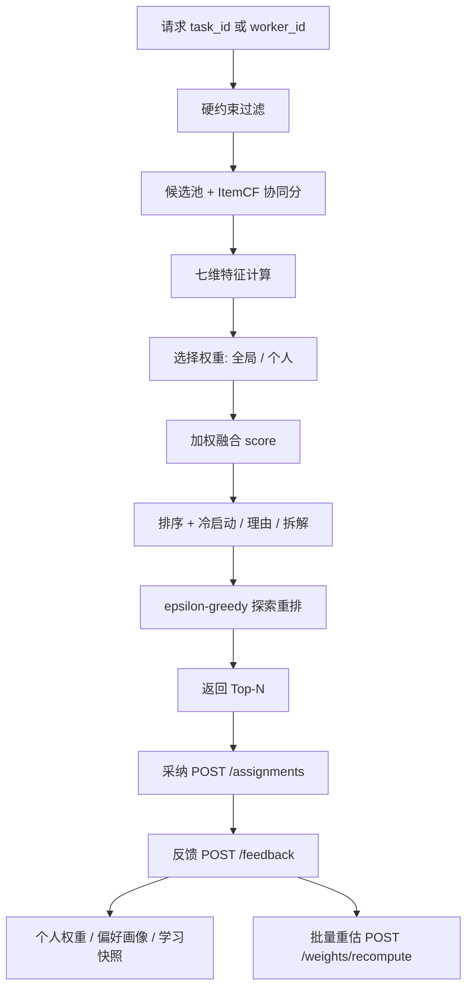

# 任务推荐机制：完整流程

> 版本：2026-11-13  
> 代码目录：`generated/task-recommender/`  
> 范围：主推荐链路、验收学习链路、1000 任务对答案基准

---

## 1. 总览

系统里目前有三条相关但不同的链路：

| 链路 | 入口 | 是否有标准答案 | 作用 |
|---|---|---|---|
| **A. 主推荐** | `POST /recommend/workers`、`POST /recommend/tasks` | 否 | 线上任务 ↔ 人双向 Top-N |
| **B. 验收学习** | `/submissions` → `/review` → `/decision` | 部分（验收标准） | 判断交付是否合格，并更新能力与客户权重 |
| **C. 对答案基准** | `POST /benchmark/run` | 是（`labels` 表） | 离线验证学习是否让推荐变准 |

主推荐链路使用结构化 `Task` / `Worker` 数据；自然语言分类是上游入口，尚未自动落库成 `Task`。对答案基准直接使用自然语言简历和任务文本。

---

## 2. 主推荐链路

### 2.1 流程图



纯文本版：

```text
请求
  → 硬约束过滤
  → 候选池 + ItemCF
  → 七维特征
  → 全局/个人权重
  → 加权融合
  → 排序 + 解释
  → epsilon-greedy 探索
  → Top-N
  → 采纳 → 反馈 → 学习 / 版本
```

### 2.2 输入

**任务 → 人**

```json
{
  "task_id": "t0001",
  "top_n": 5,
  "user_id": "c0001"
}
```

**人 → 任务**

```json
{
  "worker_id": "w0001",
  "top_n": 5,
  "user_id": "w0001"
}
```

`user_id` 可选。传入时优先使用该用户的个人权重；否则使用当前激活的全局权重版本。

### 2.3 硬约束过滤

每个候选先过资格判断，不满足直接淘汰：

```text
task.status == "open"
worker.status == "active"
worker.skills[skill] >= task.required_skills[skill]
worker.level >= task.required_level
worker.current_load_hours + task.estimated_hours <= worker.capacity_hours
该 worker 没有已经接过这个 task
最近 180 天违约次数 < 2
```

人 → 任务时，还会排除该 worker 已接过的任务。

违约分级：

- 1 次：警告，仍可推荐；
- ≥2 次：排除。

代码：`app/service.py::is_eligible`。

### 2.4 候选池与协同分

```text
pool_size = min(100, max(top_n * 3, top_n + 1))
```

ItemCF 只用 `completed` 的历史分配：

- 有客户评分的 pair 权重 `1.0`；
- 无评分的 pair 权重 `0.5`；
- 归一化后得到 `collaborative` 分。

没有历史记录的 worker 标记 `cold_start=true`。

代码：`app/service.py::_build_itemcf`。

### 2.5 七维特征

每个候选计算 7 个 0–1 分：

| 维度 | 计算 |
|---|---|
| `reputation` | 0.4 贝叶斯评分 + 0.2 完成率 + 0.2 按时率 + 0.1 返工 + 0.1 违约惩罚 |
| `skill` | 任务要求技能逐项 `min(worker_skill / required, 1)` 后取平均 |
| `expertise` | worker 在任务类别上的专长分 / 5 |
| `collaborative` | ItemCF 协同分 |
| `preference` | worker 的类别偏好 + 难度匹配；有学习画像时用画像 |
| `load` | `(capacity - current_load - task_hours) / capacity` |
| `customer_preference` | 客户画像的偏好加权；无画像时 `0.5 reputation + 0.3 expertise + 0.2 load` |

**信誉公式**

```text
bayesian_rating = (sum(ratings) + 10 * 4.2) / (len(ratings) + 10) / 5

reputation =
    0.4 * bayesian_rating
  + 0.2 * completion
  + 0.2 * on_time
  + 0.1 * rework
  + 0.1 * breach_penalty
```

其中：

```text
completion = completed / (completed + total_breaches)
on_time = on_time / completed
rework = 1 - min(rework_count / completed, 1)
breach_penalty = 1.0（近 180 天 0 次）
               = 0.5（1 次）
               = 0.0（≥2 次）
```

分类信誉向全局信誉收缩：

```text
category_reputation = (n * category_mean + 10 * global_score) / (n + 10)
```

代码：`app/features.py`、`app/reputation.py`。

### 2.6 选择权重

优先级：

```text
请求带 user_id 且已有个人权重 → 个人权重
否则 → 当前激活的全局权重版本
```

默认全局权重：

| 维度 | 权重 |
|---|---|
| reputation | 0.32 |
| skill | 0.20 |
| expertise | 0.15 |
| collaborative | 0.13 |
| preference | 0.10 |
| load | 0.06 |
| customer_preference | 0.04 |

个人权重遵循三级结构：

```text
全局先验 → 分群权重 → 个人权重
```

- 新用户冷启动使用全局/分群先验；
- 有画像声明时叠加 `preference_bias`；
- 累计反馈后按 `n/(n+20)` 收缩到个人权重。

代码：`app/personalization/`、`app/versioning.py`。

### 2.7 融合打分

```text
score = Σ(weight_i × feature_i)
```

权重必须和为 1.0；最终分数截断到 `[0, 1]`。

```python
score = sum(
    features.get(key, 0.0) * weight
    for key, weight in weights.items()
)
```

代码：`app/features.py::fuse_scores`。

### 2.8 排序与解释

按分数降序，同分按 ID 稳定排序，取 `pool_size`。每个候选返回：

- `score`
- `breakdown`：七维明细
- `reasons`：如 `skill=0.82`、`reputation=0.71`、`cold start`
- `cold_start`
- `propensity`

### 2.9 探索重排

Top-N 前做 epsilon-greedy：

```text
epsilon = 0.10
```

- 90% 保留原 Top-N；
- 10% 从剩余候选随机替换最后一名；
- exploited 候选 `propensity = 0.9`；
- explored 候选 `propensity = 1 / 候选数`。

propensity 会随采纳记录写入分配，供 IPS/SNIPS 评估。

代码：`app/learning/exploration.py`。

### 2.10 返回 Top-N

最终返回 `top_n` 个候选。前端展示分数拆解、推荐理由和冷启动标记。

---

## 3. 采纳、反馈与学习链路

### 3.1 采纳

`POST /assignments`

记录：

```text
task_id
worker_id
customer_id
recommendation_score
recommendation_rank
propensity
weights_version
```

重复分配返回 409。

### 3.2 客户反馈

`POST /feedback`

记录 1–5 分总评，以及质量、时效、沟通分项。

副作用：

1. 更新 worker 的评分、分类评分、完成数、按时数；
2. 用当前七维特征和客户评分更新 worker 个人权重；
3. 更新 worker 偏好画像；
4. 更新 customer 偏好画像；
5. 写学习快照。

重复反馈返回 409。

### 3.3 全局权重重估

`POST /weights/recompute`

```text
收集所有“分配 + 反馈”记录
  → 构造 (features, rating)
  → OnlineWeightLearner.batch_fit
  → 生成新的全局权重版本
```

支持：

- `GET /weights/diff?from=v0000&to=v0001`
- `POST /weights/rollback`

代码：`app/learning/online.py`、`app/versioning.py`。

### 3.4 验收驱动学习

验收链路：

```text
提交交付物
  → 机器校验
  → 同行 / 客户评分
  → 接受 / 返工 / 驳回 / 争议
  → 写验收记录
  → 更新执行者能力
  → 更新客户个人权重
```

验收维度到权重信号的映射：

| 验收信号 | 权重影响 |
|---|---|
| 洞察评分高 | `expertise` / `reputation` ↑ |
| 引用不一致 | `expertise` ↓ |
| 逾期 | `load` ↓ |
| 首次通过 | `reputation` / `customer_preference` ↑ |
| 返工 | `reputation` ↓，保留返工惩罚 |
| 争议 | 不进入学习 |

争议规则：

- 硬门槛失败不能“接受”；
- 客户驳回但指不出失败标准 → 自动转为 `disputed`；
- `disputed` 不进入学习。

代码：`app/acceptance/`。

---

## 4. 1000 任务对答案基准

### 4.1 数据

SQLite：`data/benchmark/task_benchmark.sqlite`

| 表 | 内容 |
|---|---|
| `workers` | 100 份自然语言简历 |
| `customers` | 客户偏好 |
| `tasks` | 1,000 条自然语言任务，800 训练 / 200 测试 |
| `labels` | `task_id → gold_worker_id`，答案单独存放 |
| `rounds` | 每轮 Top-1 / Top-5 / MRR / NDCG / 权重 |
| `recommendations` | 每轮 Top-5 推荐记录 |

推荐器只读 `workers` / `tasks` / `customers`，不读 `labels`。

### 4.2 每轮协议

```text
第 N 轮开始
  → 清空上一轮推荐缓存（不重置权重）
  → 用当前权重重算全部 1,000 个任务
  → 对答案：Top-1 / Top-5 / MRR / NDCG
  → 只用 800 条训练任务的答案做 listwise 学习
  → 保存权重和第 N 轮推荐
第 N+1 轮
  → 再次清空推荐缓存
  → 重新推荐
```

“遗忘答案”的实现是：**推荐缓存清空，学到的权重保留**。下一轮不能靠记住上一轮的 task→worker，只能靠权重泛化。

### 4.3 特征

- 字符 2–4 gram TF-IDF 相似度；
- 任务技能与简历技能重叠；
- 信誉；
- 负载；
- 区域/远程匹配；
- worker 类别偏好；
- 客户类别偏好。

### 4.4 学习

- listwise softmax，候选集为当前 Top-20；
- 学习率 `0.05`；
- 只用 800 条训练任务；
- 每轮更新一次权重。

### 4.5 10 轮结果

| 轮次 | Top-1 | Top-5 | 测试 Top-1 |
|---|---|---|---|
| R1 | 0.563 | 0.913 | 0.560 |
| R2 | 0.612 | 0.959 | 0.625 |
| R3 | 0.619 | 0.972 | 0.635 |
| R4 | 0.668 | 0.979 | 0.670 |
| R5 | 0.674 | 0.985 | 0.670 |
| R6 | 0.690 | 0.988 | 0.695 |
| R7 | 0.708 | 0.988 | 0.735 |
| R8 | 0.722 | 0.989 | 0.750 |
| R9 | 0.726 | 0.995 | 0.765 |
| R10 | 0.731 | 1.000 | 0.750 |

可视化：

- `reports/benchmark_curve.png/svg`
- `reports/benchmark_curve_dark.png/svg`
- `reports/benchmark_visual.md`

脚本：

```bash
python scripts/build_benchmark.py
python scripts/run_benchmark_rounds.py --rounds 10
python scripts/plot_benchmark.py
```

---

## 5. 三条链路的区别

| 维度 | 主推荐 | 验收学习 | 对答案基准 |
|---|---|---|---|
| 输入 | 结构化 Task / Worker | 交付物 + 验收标准 | 自然语言任务 + 简历 |
| 是否有 gold label | 否 | 部分 | 是 |
| 学习触发 | 客户反馈、批量重估 | 验收决策 | 每轮对答案后 |
| 更新对象 | 全局/个人权重、偏好画像 | 客户个人权重、能力指标 | 基准权重 |
| 评估指标 | 业务反馈、IPS | 一次通过率、返工率、争议率 | Top-1 / Top-5 / MRR / NDCG |
| 主要代码 | `app/service.py` | `app/acceptance/` | `app/benchmark/` |

---

## 6. 当前边界

1. **自然语言尚未自动进入主推荐**：`/classify` 能识别类别和字段，但还需要显式创建 `Task`。
2. **简历视图是展示层**：`/workers/{id}/resume` 不改变主推荐特征；基准链路才直接使用简历文本。
3. **验收只支持 `consulting_research`**：其他类别返回 422。
4. **学习是事件驱动的**：反馈、验收、批量重估会更新权重；没有实时点击流学习。
5. **对答案基准和线上推荐是两套评估**：基准有标准答案，线上只有反馈和验收结果。
6. **基准使用固定 1,000 条任务**：衡量权重恢复，不是完全未见过任务的泛化；可继续扩展 rolling test。

---

## 7. 关键代码索引

| 模块 | 文件 |
|---|---|
| 推荐编排 / 硬约束 / 排序 | `app/service.py` |
| 七维特征 / 融合 | `app/features.py` |
| 信誉 / 违约 | `app/reputation.py` |
| 探索与 propensity | `app/learning/exploration.py` |
| 在线学习 / 批量重估 | `app/learning/online.py` |
| 三级个性化 | `app/personalization/` |
| 反馈与信誉聚合 | `app/feedback.py` |
| 权重版本 / 回滚 | `app/versioning.py` |
| 自然语言分类 | `app/nlp/` |
| 验收闭环 | `app/acceptance/` |
| 对答案基准 | `app/benchmark/` |
| API 路由 | `app/main.py` |
| 前端 | `frontend/` |
