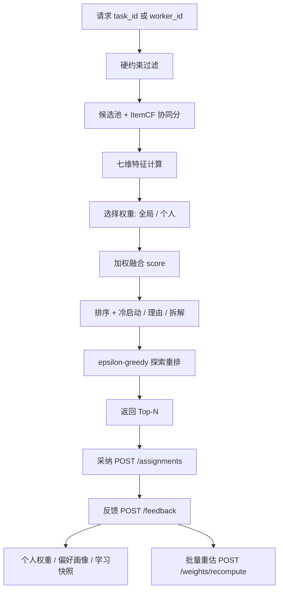

# 任务推荐机制：完整流程

> 版本：2026-11-14  
> 代码目录：`task-recommender/`  
> 范围：主推荐链路、验收学习链路、1000 任务对答案基准

---

## 1. 总览

系统里目前有三条相关但不同的链路：

| 链路 | 入口 | 是否有标准答案 | 作用 |
|---|---|---|---|
| **A. 主推荐** | `POST /recommend/workers`、`POST /recommend/tasks` | 否 | 线上任务 ↔ 人双向 Top-N |
| **B. 验收学习** | `/submissions` → `/review` → `/decision` | 部分（验收标准） | 判断交付是否合格，并更新能力与客户权重 |
| **C. 对答案基准** | `POST /benchmark/run` | 是（`labels` 表） | 离线验证学习是否让推荐变准 |

主推荐链路使用结构化 `Task` / `Worker` 数据；自然语言分类是上游入口，尚未自动落库成 `Task`。对答案基准直接使用自然语言简历和任务文本。

---

## 2. 主推荐链路

### 2.1 流程图



纯文本版：

```text
请求 → 硬约束 → 候选 + ItemCF → 语义/七维特征 → 权重 → 精确 ε-greedy
→ Top-N + request_id → impression → click/apply/accept/reject/ignore
→ pairwise/listwise 选择学习 → 权重版本 / 校准 / 回滚
```

事件与选择学习不改变排序器本身：排序仍是七维线性融合，选择学习只估计这七个权重。`strict` 评估在独立的 train-only Store 上重放 test 查询，不读取训练期不可见的数据。

### 2.2 输入

**任务 → 人**

```json
{
  "task_id": "t0001",
  "top_n": 5,
  "user_id": "c0001"
}
```

**人 → 任务**

```json
{
  "worker_id": "w0001",
  "top_n": 5,
  "user_id": "w0001"
}
```

`user_id` 可选。传入时优先使用该用户的个人权重；否则使用当前激活的全局权重版本。

### 2.3 硬约束过滤

每个候选先过资格判断，不满足直接淘汰：

```text
task.status == "open"
worker.status == "active"
worker.skills[skill] >= task.required_skills[skill]
worker.level >= task.required_level
worker.current_load_hours + task.estimated_hours <= worker.capacity_hours
该 worker 没有已经接过这个 task
最近 180 天违约次数 < 2
```

人 → 任务时，还会排除该 worker 已接过的任务。

违约分级：

- 1 次：警告，仍可推荐；
- ≥2 次：排除。

代码：`app/service.py::is_eligible`。

### 2.4 候选池与协同分

```text
pool_size = min(100, max(top_n * 3, top_n + 1))
```

ItemCF 只用 `completed` 的历史分配：

- 有客户评分的 pair 权重 `1.0`；
- 无评分的 pair 权重 `0.5`；
- 归一化后得到 `collaborative` 分。

没有历史记录的 worker 标记 `cold_start=true`。

代码：`app/service.py::_build_itemcf`。

### 2.5 七维特征

每个候选计算 7 个 0–1 分：

| 维度 | 计算 |
|---|---|
| `reputation` | 0.4 贝叶斯评分 + 0.2 完成率 + 0.2 按时率 + 0.1 返工 + 0.1 违约惩罚 |
| `skill` | 任务要求技能逐项 `min(worker_skill / required, 1)` 后取平均 |
| `expertise` | worker 在任务类别上的专长分 / 5 |
| `collaborative` | ItemCF 协同分 |
| `preference` | worker 的类别偏好 + 难度匹配；有学习画像时用画像 |
| `load` | `(capacity - current_load - task_hours) / capacity` |
| `customer_preference` | 客户画像的偏好加权；无画像时 `0.5 reputation + 0.3 expertise + 0.2 load` |

**信誉公式**

```text
bayesian_rating = (sum(ratings) + 10 * 4.2) / (len(ratings) + 10) / 5

reputation =
    0.4 * bayesian_rating
  + 0.2 * completion
  + 0.2 * on_time
  + 0.1 * rework
  + 0.1 * breach_penalty
```

其中：

```text
completion = completed / (completed + total_breaches)
on_time = on_time / completed
rework = 1 - min(rework_count / completed, 1)
breach_penalty = 1.0（近 180 天 0 次）
               = 0.5（1 次）
               = 0.0（≥2 次）
```

分类信誉向全局信誉收缩：

```text
category_reputation = (n * category_mean + 10 * global_score) / (n + 10)
```

代码：`app/features.py`、`app/reputation.py`。

### 2.6 选择权重

优先级：

```text
请求带 user_id 且已有个人权重 → 个人权重
否则 → 当前激活的全局权重版本
```

AHP 先验/基线全局权重（`DEFAULT_WEIGHTS`；实际 serving 权重来自 `data/weights/active.json`，当前为 `scripts/tune_weights.py` + `scripts/activate_weights.py` 激活的 choice-tuned 版本）：

| 维度 | 权重 |
|---|---|
| reputation | 0.32 |
| skill | 0.20 |
| expertise | 0.15 |
| collaborative | 0.13 |
| preference | 0.10 |
| load | 0.06 |
| customer_preference | 0.04 |

个人权重遵循三级结构：

```text
全局先验 → 分群权重 → 个人权重
```

- 新用户冷启动使用全局/分群先验；
- 有画像声明时叠加 `preference_bias`；
- 累计反馈后按 `n/(n+20)` 收缩到个人权重。

代码：`app/personalization/`、`app/versioning.py`。

### 2.7 融合打分

```text
score = Σ(weight_i × feature_i)
```

权重必须和为 1.0；最终分数截断到 `[0, 1]`。

```python
score = sum(
    features.get(key, 0.0) * weight
    for key, weight in weights.items()
)
```

代码：`app/features.py::fuse_scores`。

### 2.8 排序与解释

按分数降序，同分按 ID 稳定排序，取 `pool_size`。每个候选返回：

- `score`
- `breakdown`：七维明细
- `reasons`：如 `skill=0.82`、`reputation=0.71`、`cold start`
- `cold_start`
- `propensity`

### 2.9 探索重排

Top-N 前做 epsilon-greedy：

```text
epsilon = 0.10
```

- 90% 保留原 Top-N；
- 10% 从第 K 名及其后的 tail 中均匀采样，若采到 tail 则替换最后一名；
- 记录的是**包含概率**（inclusion probability），不是“是否被探索”的标记。

设候选池大小为 `N`、返回 `K = min(k, N)`、探索率 `ε`、探索池大小 `N-K+1`：

```text
top-(K-1) 候选：p = 1.0
第 K 名候选：    p = (1 - ε) + ε / (N - K + 1)
第 K 名之后：    p = ε / (N - K + 1)
N <= K：         p = 1.0（全部返回）
```

propensity 会随采纳记录写入分配，供 IPS/SNIPS 评估。

代码：`app/learning/exploration.py`。

### 2.10 返回 Top-N

最终返回 `top_n` 个候选与 `request_id`。前端展示分数拆解、推荐理由和冷启动标记。

### 2.11 曝光、事件与 propensity

每次推荐返回 `request_id`，服务端写入一条 `Impression`：

```text
request_id
query_id（task_id 或 worker_id）
candidate_ids
propensities（每个候选的 logging propensity）
policy（如 epsilon_greedy）
metadata（candidate_type、task_id、assignment_id 等）
```

客户端随后调用 `POST /events` 上报以下动作：

```text
click / apply / accept / reject / ignore
```

每个动作写成一条 `RecommendationEvent`，包含 `request_id`、`candidate_id`、`rank`、`score`、`propensity`、`weights_version` 与 `action`。`GET /events/metrics` 聚合曝光数、候选数、点击率、申请率、接受率、拒绝率与忽略率。

服务端不信任客户端的目标标签：`candidate_type` 与 `task_id` 从对应 `Impression` 派生（worker 曝光的 `task_id=query_id`；task 曝光的 `task_id=candidate_id`），客户端显式字段只用于一致性校验，不匹配返回 409；客户端 metadata 只保留 allowlist（`candidate_type`/`task_id`/`score`/`weights_version`）。`POST /assignments` 携带 `request_id` 时，只有 task 匹配且 candidate 在曝光集合内才自动写 accept，并使用印象的 role/user。`/events` 单批最多 200 条、metadata 最多 20 个键/2000 字符，请求体超过 1 MB 在 JSON 解析前返回 413。事件追加写使用内存行计数与重复键集合，避免每次 append 重扫整个 JSONL；持久化文件仅作审计，不在启动时回放。

`propensity` 是精确的 logging **包含概率**，而不是事后估计：

```text
设 N = 候选池大小，K = min(k, N)，ε = 探索率，探索池大小 = N - K + 1
top-(K-1) 候选：p = 1.0
第 K 名候选：    p = (1 - ε) + ε / (N - K + 1)
第 K 名之后：    p = ε / (N - K + 1)
N <= K：         p = 1.0
```

事件、采纳记录与 IPS/SNIPS 评估复用同一个 propensity，保证日志策略可回放。

### 2.12 严格评估（strict evaluation）

`scripts/evaluate_strict.py` 使用独立的严格评估协议：

```text
train 数据 → 构造 train-only Store 与全部特征（含 ItemCF）
test 查询 → 只用于评分（排序与 HR/NDCG/MRR）与构造 exposed 候选集
test 反馈 → 只用于校准评估标签（rating>=4），不参与特征或训练
baseline 权重 vs candidate 权重 → 同一次生成的数据上成对比较
```

- Serving parity：每个 seed 用 train-only Store 拟合 `SemanticMatcher`（worker/task 文本）与 `AcceptanceModel`（train accept/reject 事件），注入 baseline/candidate/验证服务；JSON 报告 `serving_features.parity="serving"`。
- 指标：双向 `HR@k`、`NDCG@k`、`MRR@k`；每个 test 查询成一个成对样本。
- 置信区间：对逐查询 delta 做配对 bootstrap（默认 1000 次）。
- 护栏：约束违规数；`scoring_latency_p50_ms/p95_ms` 仅是进程内打分时间，HTTP 端点 2× 护栏标记为 `endpoint_latency.guardrail="N/A"`。
- 冷启动：JSON 包含 `cold_start.available`、`cold_start.reason`、`cold_start.queries`、`cold_start.measured`；只有 `available=true` 且 `queries>0` 时 `measured` 才为 true，否则报告 N/A。
- 校准：在 train 分数/标签上拟合 `PlattCalibrator`，在 test 上报告 `P(rating>=4)` 的 Brier 分数与可靠性分箱；校准不参与排序。
- 身份检查：`baseline_equals_candidate=true`（有效权重在浮点容差内相同）时不得宣称提升。

规范调优证据（serving-parity 特征 + 验证集调参 + 5 seed 严格测试）：

```bash
python scripts/tune_weights.py --seeds 42,43,44,45,46 --k 10
python scripts/activate_weights.py --input data/weights/weights_choice.json
```

结果写入 `reports/strict_eval_tuned.json` / `reports/strict_eval_tuned.md`，并把 `weights_choice.json` 激活为 WeightStore 版本（`data/weights/active.json` 指向它）。通用严格评估可显式传入候选权重：

```bash
python scripts/evaluate_strict.py --seeds 42,43,44,45,46 --k 10 \
  --candidate-weights data/weights/weights_choice.json
```

评估器在每个 seed 内用 train-only Store 拟合与 serving 相同的 `SemanticMatcher` 和 `AcceptanceModel` 并注入 baseline/candidate 服务（JSON 字段 `serving_features.parity="serving"`）；test 数据只用于排序评分与校准标签。`scoring_latency_p50_ms/p95_ms` 是进程内打分时间，不是 HTTP 端点延迟，端点 2× 护栏在评估报告中明确为 `endpoint_latency.guardrail="N/A"`。不传 `--candidate-weights` 时使用 active 权重；若与 baseline 相同，则报 identity 且不宣称提升。

报告写入 `reports/strict_eval.json` 与 `reports/strict_eval.md`。当前 tuned 证据（`reports/strict_eval_tuned.*`，5 seeds，serving parity）：worker→tasks HR@10 `0.0637 → 0.2070`（+14.33pp），NDCG@10 `0.0258 → 0.0991`（+283.55%）；task→workers HR +0.60pp / NDCG +0.21%（均值不劣化）；约束违规 0；冷启动 N/A；端点延迟 N/A；目标 **MET**。旧 `weights_v0007.json` 的 NOT MET 报告已被取代。

---

## 3. 采纳、反馈与学习链路

### 3.1 采纳

`POST /assignments`

记录：

```text
task_id
worker_id
customer_id
recommendation_score
recommendation_rank
propensity
weights_version
```

重复分配返回 409。

### 3.2 客户反馈

`POST /feedback`

记录 1–5 分总评，以及质量、时效、沟通分项。

副作用：

1. 更新 worker 的评分、分类评分、完成数、按时数；
2. 用当前七维特征和客户评分更新 worker 个人权重；
3. 更新 worker 偏好画像；
4. 更新 customer 偏好画像；
5. 写学习快照。

重复反馈返回 409。

### 3.3 全局权重重估

`POST /weights/recompute`

```text
收集所有“分配 + 反馈”记录
  → 构造 (features, rating)
  → OnlineWeightLearner.batch_fit
  → 生成新的全局权重版本
```

支持：

- `GET /weights/diff?from=v0000&to=v0001`
- `POST /weights/rollback`

代码：`app/learning/online.py`、`app/versioning.py`。

### 3.4 验收驱动学习

验收链路：

```text
提交交付物
  → 机器校验
  → 同行 / 客户评分
  → 接受 / 返工 / 驳回 / 争议
  → 写验收记录
  → 更新执行者能力
  → 更新客户个人权重
```

验收维度到权重信号的映射：

| 验收信号 | 权重影响 |
|---|---|
| 洞察评分高 | `expertise` / `reputation` ↑ |
| 引用不一致 | `expertise` ↓ |
| 逾期 | `load` ↓ |
| 首次通过 | `reputation` / `customer_preference` ↑ |
| 返工 | `reputation` ↓，保留返工惩罚 |
| 争议 | 不进入学习 |

争议规则：

- 硬门槛失败不能“接受”；
- 客户驳回但指不出失败标准 → 自动转为 `disputed`；
- `disputed` 不进入学习。

代码：`app/acceptance/`。

---

## 4. 1000 任务对答案基准

### 4.1 数据

SQLite：`data/benchmark/task_benchmark.sqlite`

| 表 | 内容 |
|---|---|
| `workers` | 100 份自然语言简历 |
| `customers` | 客户偏好 |
| `tasks` | 1,000 条自然语言任务，800 训练 / 200 测试 |
| `labels` | `task_id → gold_worker_id`，答案单独存放 |
| `rounds` | 每轮 Top-1 / Top-5 / MRR / NDCG / 权重 |
| `recommendations` | 每轮 Top-5 推荐记录 |

推荐器只读 `workers` / `tasks` / `customers`，不读 `labels`。

### 4.2 每轮协议

```text
第 N 轮开始
  → 清空上一轮推荐缓存（不重置权重）
  → 用当前权重重算全部 1,000 个任务
  → 对答案：Top-1 / Top-5 / MRR / NDCG
  → 只用 800 条训练任务的答案做 listwise 学习
  → 保存权重和第 N 轮推荐
第 N+1 轮
  → 再次清空推荐缓存
  → 重新推荐
```

“遗忘答案”的实现是：**推荐缓存清空，学到的权重保留**。下一轮不能靠记住上一轮的 task→worker，只能靠权重泛化。

### 4.3 特征

- 字符 2–4 gram TF-IDF 相似度；
- 任务技能与简历技能重叠；
- 信誉；
- 负载；
- 区域/远程匹配；
- worker 类别偏好；
- 客户类别偏好。

> **已知缺口**：**1,000 任务对答案基准**的 `app/benchmark/recommender.py` 没有向 `BenchmarkFeatureBuilder` 传入 ItemCF，因此该基准的 `collaborative` 恒为 `0.0`；主推荐链路的 ItemCF 正常。Task 21 新增的 **10,000 任务大规模基准**（`app/benchmark/large.py`）单独接入 strict train-only ItemCF，但测试任务在训练图上冷启动，所以其 `collaborative` 评估值仍为 0；两个基准不可混用。见 `reports/large_benchmark_eval.md`。

### 4.4 学习

- listwise softmax，候选集为当前 Top-20；
- 学习率 `0.05`；
- 只用 800 条训练任务；
- 每轮更新一次权重。

### 4.5 20 轮结果

| 轮次 | Top-1 | Top-5 | 测试 Top-1 |
|---|---|---|---|
| R1 | 0.367 | 0.872 | 0.365 |
| R2 | 0.401 | 0.907 | 0.385 |
| R3 | 0.446 | 0.934 | 0.450 |
| R4 | 0.530 | 0.948 | 0.540 |
| R5 | 0.530 | 0.953 | 0.545 |
| R6 | 0.532 | 0.954 | 0.535 |
| R7 | 0.540 | 0.952 | 0.545 |
| R8 | 0.545 | 0.951 | 0.555 |
| R9 | 0.546 | 0.950 | 0.555 |
| R10 | 0.568 | 0.946 | 0.580 |
| R11 | 0.568 | 0.944 | 0.580 |
| R12 | 0.565 | 0.945 | 0.575 |
| R13 | 0.565 | 0.944 | 0.580 |
| R14 | 0.565 | 0.936 | 0.585 |
| R15 | 0.564 | 0.936 | 0.580 |
| R16 | 0.561 | 0.936 | 0.575 |
| R17 | 0.561 | 0.935 | 0.575 |
| R18 | 0.563 | 0.936 | 0.580 |
| R19 | 0.564 | 0.935 | 0.585 |
| R20 | 0.562 | 0.935 | 0.580 |

> 这是 2026-11-14 的重新基线（Task 3 特征 + Task 14 基准改动后）。R1 的 `0.367` 是 fresh baseline；20 轮不是线性上升：R10 `0.568` 后基本饱和，R20 `0.562` 轻微回落，Top-5 从 `0.946` 降到 `0.935`。R20 绝对值 `0.562` **低于历史 R10 的 `0.731`（约 -0.169）**。历史数字来自旧数据/旧特征，不能直接比较，也不能据此宣称已恢复历史水平。**1,000 任务基准的 `collaborative` 仍为 0**，见 §4.3 的已知缺口；10,000 任务大规模基准是独立的 strict train-only ItemCF，不在这张表里。

可视化：

- `reports/benchmark_curve.png/svg`
- `reports/benchmark_curve_dark.png/svg`
- `reports/benchmark_visual.md`

脚本：

```bash
python scripts/build_benchmark.py
python scripts/run_benchmark_rounds.py --rounds 20
python scripts/plot_benchmark.py
```

---

## 5. 三条链路的区别

| 维度 | 主推荐 | 验收学习 | 对答案基准 |
|---|---|---|---|
| 输入 | 结构化 Task / Worker | 交付物 + 验收标准 | 自然语言任务 + 简历 |
| 是否有 gold label | 否 | 部分 | 是 |
| 学习触发 | 客户反馈、批量重估 | 验收决策 | 每轮对答案后 |
| 更新对象 | 全局/个人权重、偏好画像 | 客户个人权重、能力指标 | 基准权重 |
| 评估指标 | 业务反馈、IPS | 一次通过率、返工率、争议率 | Top-1 / Top-5 / MRR / NDCG |
| 主要代码 | `app/service.py` | `app/acceptance/` | `app/benchmark/` |

---

## 6. 当前边界

1. **自然语言尚未自动进入主推荐**：`/classify`、`/upload/task`、`/upload/resume`、`/resume/analyze` 能识别类别、字段和语义，但 draft 仍需显式确认/创建 `Task`，上传不写 Store。
2. **简历视图是展示层**：`/workers/{id}/resume` 不改变主推荐特征；基准链路才直接使用简历文本。
3. **验收只支持 `consulting_research`**：其他类别返回 422。
4. **学习是事件驱动的**：前端现在会上报 click/apply/reject，采纳时携带 `request_id` 由服务端记录 accept；但没有实时点击流学习（事件在重算/选择学习时消费）。
5. **对答案基准和线上推荐是两套评估**：基准有标准答案，线上只有反馈和验收结果。
6. **1,000 任务基准是固定数据**：衡量权重恢复，不是完全未见过任务的泛化；Task 21 的 10,000 任务大规模基准提供独立的 strict train-only 评估。
7. **1,000 任务基准 `collaborative` 仍为 0**：`BenchmarkRecommender` 未接入 ItemCF；10,000 任务大规模基准虽接入 strict train-only ItemCF，但测试任务冷启动，collab 仍为 0。两者都不能用来宣称协同特征有效。
8. **校准不改变排序**：`P(rating>=4)` 只用于报告可解释性；排序仍由七维线性分数决定。
9. **端到端延迟护栏未测量**：严格评估只测进程内打分时间，HTTP `/recommend/*` 端点延迟标记为 N/A；不能把打分时间当作端点 p95。

---

## 7. 关键代码索引

| 模块 | 文件 |
|---|---|
| 推荐编排 / 硬约束 / 排序 | `app/service.py` |
| 七维特征 / 融合 | `app/features.py` |
| 信誉 / 违约 | `app/reputation.py` |
| 探索与 propensity | `app/learning/exploration.py` |
| 在线学习 / 批量重估 | `app/learning/online.py` |
| 三级个性化 | `app/personalization/` |
| 反馈与信誉聚合 | `app/feedback.py` |
| 权重版本 / 回滚 | `app/versioning.py` |
| 事件与漏斗指标 | `app/events.py`、`app/main.py`（`/events`） |
| 选择学习（pairwise/listwise） | `app/learning/choice.py`、`app/learning/online.py` |
| 校准报告 | `app/learning/calibration.py`、`app/evaluation_strict.py` |
| 严格评估 | `app/evaluation_strict.py`、`scripts/evaluate_strict.py` |
| 自然语言分类 | `app/nlp/` |
| 验收闭环 | `app/acceptance/` |
| 对答案基准 | `app/benchmark/` |
| API 路由 | `app/main.py` |
| 前端 | `frontend/` |
