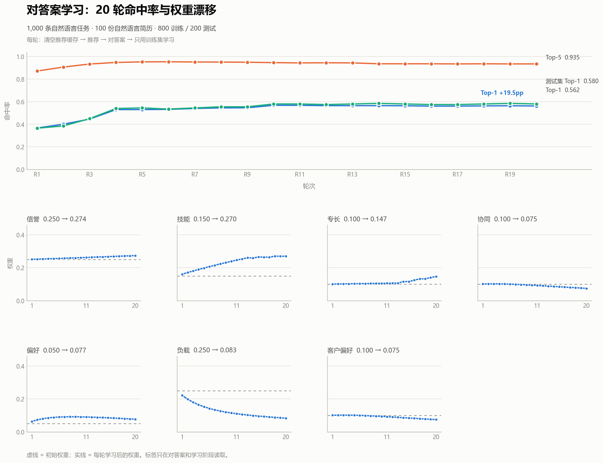
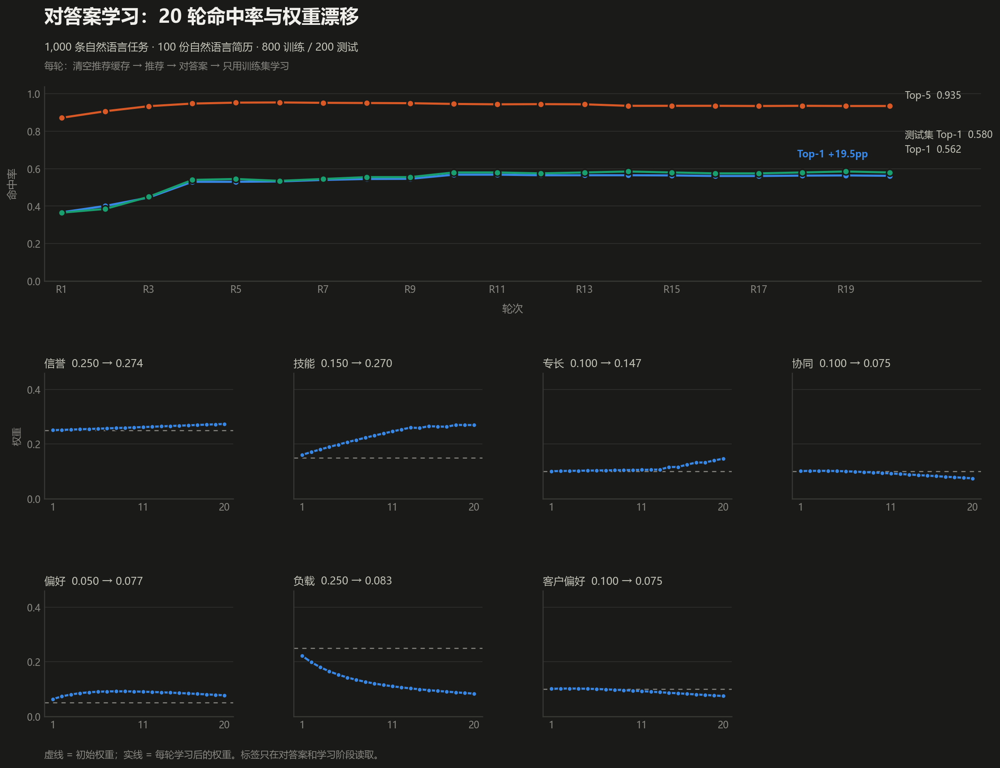

# 对答案学习可视化

## 读法

- 上半部分：Top-1、Top-5、测试集 Top-1 随轮次变化。
- 下半部分：7 个评分维度的权重漂移；虚线是初始权重，实线是每轮学习后的权重。
- 每轮先清空推荐缓存，再重新推荐；标签只在对答案和学习阶段读取。

## 20 轮数据

| 轮次 | Top-1 | Top-5 | 测试 Top-1 |
|---|---|---|---|
| R1 | 0.367 | 0.872 | 0.365 |
| R2 | 0.401 | 0.907 | 0.385 |
| R3 | 0.446 | 0.934 | 0.450 |
| R4 | 0.530 | 0.948 | 0.540 |
| R5 | 0.530 | 0.953 | 0.545 |
| R6 | 0.532 | 0.954 | 0.535 |
| R7 | 0.540 | 0.952 | 0.545 |
| R8 | 0.545 | 0.951 | 0.555 |
| R9 | 0.546 | 0.950 | 0.555 |
| R10 | 0.568 | 0.946 | 0.580 |
| R11 | 0.568 | 0.944 | 0.580 |
| R12 | 0.565 | 0.945 | 0.575 |
| R13 | 0.565 | 0.944 | 0.580 |
| R14 | 0.565 | 0.936 | 0.585 |
| R15 | 0.564 | 0.936 | 0.580 |
| R16 | 0.561 | 0.936 | 0.575 |
| R17 | 0.561 | 0.935 | 0.575 |
| R18 | 0.563 | 0.936 | 0.580 |
| R19 | 0.564 | 0.935 | 0.585 |
| R20 | 0.562 | 0.935 | 0.580 |

> 上图与上表来自 2026-11-14 的重新基线（Task 3 特征 + Task 14 基准改动后），已按 20 轮重画。
> R1 `0.367` 是 fresh baseline；20 轮不是线性上升：R10 `0.568` 后基本饱和，
> R20 `0.562` 轻微回落，Top-5 从 `0.946` 降到 `0.935`。R20 绝对值低于历史
> R10 `0.731`（约 -0.169）。历史数字来自旧数据/旧特征，只能作为历史参考，
> 不能直接比较。1,000 任务基准的 `collaborative` 仍为 0；10,000 任务大基准
> 是独立的 strict train-only ItemCF，见 `reports/large_benchmark_eval.md`。

## 文件

- `benchmark_curve.png` / `benchmark_curve.svg`：浅色版
- `benchmark_curve_dark.png` / `benchmark_curve_dark.svg`：深色版
- `benchmark_rounds.md` / `benchmark_rounds.json`：原始逐轮结果
- 生成脚本：`scripts/plot_benchmark.py`
